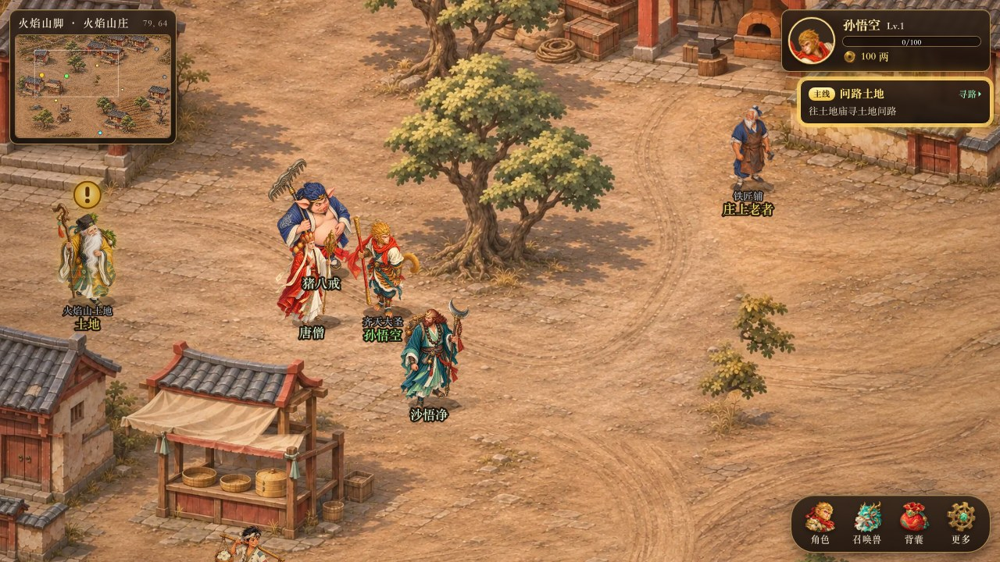
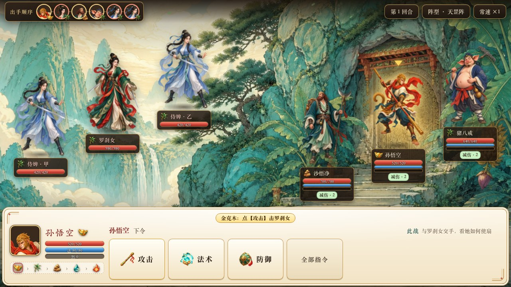

<p align="center">
  
</p>

<h1 align="center">NovelToGame</h1>

<p align="center">
  <b>把小说做成可玩游戏的 5 个 Agent 技能：通读拆书、玩法与美术策划、用本机工具构建、新玩家盲玩验收。</b>
</p>

<p align="center">
  <a href="https://zenstory.ai/zh/novel-to-game"><b>项目主页</b></a>
  &nbsp;·&nbsp;
  <a href="#安装"><b>安装</b></a>
  &nbsp;·&nbsp;
  <a href="#看看它的输出"><b>看看它的输出</b></a>
  &nbsp;·&nbsp;
  <a href="README_EN.md"><b>English</b></a>
</p>

<p align="center">
  <a href="https://github.com/zenstory-ai/novel-to-game/stargazers"></a>
  <a href="https://github.com/zenstory-ai/novel-to-game/releases/latest"></a>
  
  <a href="https://github.com/zenstory-ai/novel-to-game/actions/workflows/validate.yml"></a>
  <a href="./LICENSE"></a>
</p>

<p align="center">
  <a href="https://github.com/zenstory-ai/novel-to-game/discussions"></a>
  <a href="https://github.com/zenstory-ai/novel-to-game/issues"></a>
</p>

NovelToGame 包含 5 个开源技能，装进 Claude Code、Codex 或 Kimi Code 就能用。给它一本小说（也可以一并指定想做的平台或引擎），它会先通读全书整理设定，选出合适的玩法方向，写好策划与美术文档，再调用你机器上现有的渲染库、建模或生成工具把游戏做出来，最后以没看过源码的新玩家视角从头试玩、跑通验收，交付可玩的游戏和全套策划文档。下面两款示例都是浏览器游戏，点开就能玩。

## 在线试玩

两款示例都公开了完整目录，包含原著版本说明、玩法选型、策划与美术文档、源码和通关验收记录。

### 西游记 · 三借芭蕉扇

<p>
  <a href="https://xiyouji.vibecoco.ai"></a>
  <a href="https://xiyouji.vibecoco.ai"></a>
</p>

**一扇吹出五万里。走回去，接任务，一回合一回合把火焰山打回来。**

改编自原著第五十九至六十一回的《梦幻西游》式回合制 RPG。四张彩绘地图可点击行走，找头顶「!」的 NPC 接任务、点追踪自动寻路，主线间隙还能刷封妖令日常。攒历练与银两买装备、学法术、带召唤兽，靠五行相克、愤怒特技和七十二变打赢回合战，最后把正面硬拼不过的牛魔王变成火焰山上的一场雨。

**[浏览器试玩](https://xiyouji.vibecoco.ai)** · [改编工作区](examples/journey-to-the-west/) · 流程约 45–90 分钟 · 全年龄 · 可玩原型

### 金瓶梅 · 风月总账

<p>
  <a href="https://jinpingmei.vibecoco.ai"></a>
  <a href="https://jinpingmei.vibecoco.ai"></a>
</p>

**那年春天，五扇门都为你留过灯。你说过的话，她们都记得。**

古风恋爱互动影游，故事定在李瓶儿刚进门的那个春天。每次关键选择后都会播放一段配音短片演绎当下后果，播完停在最后一帧继续对话。共通线里五个人同桌吃饭、同历夜雨和清明家宴；你平日的一言一行攒下各自心意，决定分线那晚哪扇院门还为你亮着灯。五条个人线加无人留灯共十六种结局，剧终还会翻开她在原著里的结局。内置限时回话、画面找细节、剧情树跳章，以及画廊、回想和存档。

**[浏览器试玩](https://jinpingmei.vibecoco.ai)** · [改编工作区](examples/jin-ping-mei/) · 单线约 20–30 分钟，五线全通 1–1.5 小时 · 18+ · 可玩原型

## 这是什么

5 个技能直接调用你当前编程 Agent 的模型，按阶段各自生成一份 Markdown 文档，把原著里写了什么和游戏打算怎么改分开记清楚：

- **原著设定带出处** — 先通读全书整理出 `SOURCE_BIBLE`，理清主线脉络、关键冲突、人物关系、隐情、世界规则与改编红线，逐条标明章回或文件位置；书里没写的内容明确标为新增设定，不混充原著。
- **先比选玩法，定稿后不乱改** — 动工前先对比几个玩法方案，筛掉脱离原著冲突或单纯套壳换皮的做法。玩法概念、世界与关卡设计、美术方向分写三份文档，写代码时按定稿实现，不边写边改策划。
- **配齐同类游戏该有的外围体验** — 参考成熟品类时，会一并列清地图行走、任务指引、成长反馈等配套功能哪些要做、哪些简化、哪些不做，并写明开局第一分钟玩家看到什么。
- **锁定目标平台，用本机工具构建** — 开工前先在需求单里定好目标平台、包体积与运行环境；构建时自动检查本机可用的工具（Three.js、Blender、生图与生 3D、2D 画布、微信/抖音小游戏工具链、TapTap 制造 UrhoX+Lua、Godot/Unity 等）选择实现方案。本机没装目标引擎工具时，不会偷偷改成普通网页糊弄过关。
- **新玩家盲玩 + 通关实测** — 验收先在没读过源码和策划案的独立会话里从标题页盲玩一遍，排查卡关、引导和手机端显示问题，结果记入 `qa/playtest-report.md`；再对照策划案从头跑完启动、画面、输入、主循环、结局与重开，结果记入 `qa/verification.json`。

除了数值和回合玩法，也支持**互动叙事**与**互动影游**：互动叙事纯靠场景、对白、证词与关键选择推进，人物态度靠神情、称呼和后续剧情体现，不挂好感度面板；互动影游在每次关键选择后播放配音短片，播完停在最后一帧继续对白，关掉视频也能看静帧通关（详见[互动影游交互设计](skills/game-design/references/interactive-film-method.md)与[生成式媒体的生产与接入](skills/game-build/references/generative-media.md)）。

## 安装

前提：已安装 Claude Code、Codex 或 Kimi Code，终端能运行 `npx`（Node.js）。

| Agent CLI | 安装命令 | 调用方式 |
|---|---|---|
| Claude Code | `npx skills add zenstory-ai/novel-to-game -g -y -a claude-code -s '*'` | `/novel-to-game` |
| Codex | `npx skills add zenstory-ai/novel-to-game -g -y -a codex -s '*'` | `$novel-to-game` |
| Kimi Code | `npx skills add zenstory-ai/novel-to-game -g -y -a kimi-code-cli -s '*'` | `/skill:novel-to-game` |

`-g` 表示全局安装；去掉则只装到当前目录。**更新时重跑同一条命令，或执行 `npx skills update`。** 也可以在 [ClawHub](https://clawhub.ai/) 查看（见[发布清单](.clawhub/publish.json)）。

<details>
<summary><strong>三个 CLI 一次装齐，或用原生插件安装</strong></summary>

在同一台机器上同时装进三个 CLI（直接克隆本仓库后，三个 CLI 也会自动识别项目内的技能）：

```bash
npx skills add zenstory-ai/novel-to-game -g -y -s '*' \
  -a claude-code -a codex -a kimi-code-cli
```

#### Claude Code

```text
/plugin marketplace add zenstory-ai/novel-to-game
/plugin install novel-to-game@novel-to-game-skills
/novel-to-game:novel-to-game quick
```

#### Codex

```bash
codex plugin marketplace add zenstory-ai/novel-to-game
codex plugin add novel-to-game@novel-to-game-skills
```

#### Kimi Code 0.27 或更高版本

```text
/plugins install https://github.com/zenstory-ai/novel-to-game
/reload
/skill:novel-to-game quick
```

</details>

## 看看它的输出

以下片段直接摘自仓库里的两个示例，省略处标为“…”：

### 设计文档长什么样

以[《西游记》](examples/journey-to-the-west/)为例，[`analysis/SOURCE_BIBLE.md`](examples/journey-to-the-west/analysis/SOURCE_BIBLE.md) 先把原著里和芭蕉扇有关的细节逐条对应到章回（原表 11 行，节选 3 行）：

```markdown
| 事实 | 证据 |
|---|---|
| 真扇一扇息火、二扇生风、三扇下雨；罗刹女先用扇把悟空吹走，悟空求得灵吉菩萨定风丹后返回 | 第59回 |
| 悟空化虫入腹迫使罗刹女交扇，但拿到的是假扇；假扇连续三次使火势升高 | 第59回 |
…
| 牛魔王也会七十二变，化作八戒骗回真扇；悟空因得意而没有细察 | 第61回 |
```

[`concepts/CONCEPT.md`](examples/journey-to-the-west/concepts/CONCEPT.md) 把真假芭蕉扇定为核心机制，同时记下另外两个备选方案淘汰的原因：

```markdown
一票否决筛查结果（每方向一行）：

- 方向一·三借芭蕉扇：通过（六条均未触发）。
- 方向二·西行驿路：触发第 2 条风险——切片时长内关系积累退化为事件按钮与数值条，
  无可重复取舍——淘汰。
- 方向三·二心：触发第 3 条——真假之辨在原著由如来收束，玩家核心张力无法转成可靠
  机制（需虚构原著不存在的破绽）——淘汰。
```

[`design/GAME_DESIGN.md`](examples/journey-to-the-west/design/GAME_DESIGN.md) 写明真扇三扇各自的效果和持续回合，以及为什么决战要算准第三扇的时机：

```markdown
| 次序 | 效果（敌方全体，无视五行） | 原著对应 |
|---|---|---|
| 一扇·息火 | 清除敌方增益（保留我方所加的破防/眩晕/破绽），敌方攻击 −30%（3 回合） | 一扇息火 |
| 二扇·生风 | 全队速度 +30%（3 回合），抢下整条行动队列的先手 | 二扇生风 |
| 三扇·落雨 | 全队持续回血（每次行动回 8% 最大体力，3 回合）；敌方防御 −25% 且**露出破绽（受伤 +60%）**，均 3 回合 | 三扇下雨 |

三段既是战力曲线，也是「三借芭蕉扇」的仪式：先压制敌方攻势、再抢速、后开破绽窗口集火，
配合携宠与变化拿下白牛真身。落雨的破绽期是决战唯一的速决窗口——白牛真身每回合狂暴叠攻，
拖下去必被反杀，所以「三扇何时开」是决战的核心决策。
```

[`qa/verification.json`](examples/journey-to-the-west/qa/verification.json) 记录了浏览器从头打通结局并重开游戏的实测结果：

```json
"completeRun": {
  "id": "three-fans-main-path",
  "cleanContext": true,
  "terminal": "done",
  "restart": "ask",
  "evidence": "qa/evidence/run.json"
},
"checks": {
  "launch": "PASS",
  "render": "PASS",
  "input": "PASS",
  "coreLoop": "PASS",
  "outcome": "PASS",
  "restart": "PASS"
},
```

### 选择如何影响后续剧情

[《金瓶梅》](examples/jin-ping-mei/)的 [`concepts/CONCEPT.md`](examples/jin-ping-mei/concepts/CONCEPT.md) 梳理了每位女主的诉求、心结与原著章回出处（原表 5 行，节选 3 行）：

```markdown
核心句：**你说过的话，她们都记得。**
…
| 人物 | 她要什么 | 她的伤口 | 原作依据 |
|---|---|---|---|
| 吴月娘 | 重要的事先问她 | 只在人前是正头娘子 | 第1、21回 |
| 潘金莲 | 被看见、被优先选择 | 除了你看她那一眼，什么都没有 | 第8、9、38回 |
| 李瓶儿 | 安全与确定 | 先被看成箱子，后被看成人 | 第14、16、19回 |
```

[`design/GAME_DESIGN.md`](examples/jin-ping-mei/design/GAME_DESIGN.md) 规定界面不显示好感数字，每条个人线的关键抉择都围绕各自心结展开，并写清结局判定规则（原表 5 行，节选 2 行）：

```markdown
选择不显示数值。好感只有三种出口：她的表情与台词；分岔夜院门是否「亮着灯」；系统菜单里可选的「心意」一瞥
（只有她的神色和「灯亮着／灯将熄」，不给档位与数字）。规则在第一章由月娘说出：清明席散那夜，还亮着灯的门才进得去。
…
| 人物 | 原作依据 | 关键抉择（正确做法） | 良缘 | 寻常 | 错过 |
|---|---|---|---|---|---|
…
| 潘金莲 | 第8、38回：寄词盼人、雪夜弄琵琶 | 不替她开瓶儿的箱子，但今夜陪她 | 琵琶不冷 | 半掩的角门 | 扇子落地 |
| 李瓶儿 | 第14、19回：过墙托付、入门受冷 | 不收她的钥匙；当众说她的银子是她的 | 钥匙在她手里 | 窗下的茶 | 箱笼 |
…
结局判定：关键抉择做错 → 错过；做对且该人心意 ≥7 并在最后一问说真话 → 良缘；其余 → 寻常。
```

## 怎么用

把小说文件、目录或链接发给 Agent，复制下面任一提示词按需修改即可。

**做一款带原创路线的系统玩法游戏：**

```text
用 novel-to-game quick 把这本小说改成一款完整可玩的游戏。
请根据原著推荐平台、玩法类型和引擎，第一版流程控制在 15 分钟左右。
让玩家以原创角色进入世界，在原著冲突里走出一条新路线。
```

**做互动小说 / 互动叙事：**

```text
用 novel-to-game quick 把这本小说改成一款互动叙事游戏。
用连续场景、人物对白、证词和关键选择推进剧情；后台记录前因后果，界面上不放常驻数值面板。
关键选择要改变后续场景、人物态度和结局，并在后文有所呼应。
```

**只出策划案，暂不写代码：**

```text
基于这本我有改编权的小说，为目标引擎做一份轻量可玩切片策划案。
控制分支与结局规模，写清每个选项的依据、代价、场面变化，以及后续哪场戏会呼应。
标明新增设定与待定问题。只交付设计文档，不写代码、不做运行验收。
```

**做微信/抖音小游戏或 TapTap 制造游戏：**

```text
用 novel-to-game quick 把这本小说改成竖屏微信/抖音小游戏（或 TapTap 制造 UrhoX+Lua 小游戏）。
单局 2–3 分钟，开局 30 秒内进入冲突，结算页生成可分享的命数判词卡；可用激励广告提供提示与重来，不锁主线剧情。
按目标平台规范交付工程；本机缺少对应开发者工具时，经确认后再用本地测试页验收。
```

默认的 `quick` 模式会自动给出推荐方案，只在平台、核心玩法、版权合规或付费生成等关键问题上停下来问你，其余自动跑完设计、构建和验收。想在玩法选型、灰盒取舍和视觉样张上亲自拍板，把 `quick` 换成 `director` 即可。

## 工作流

```text
小说 → 通读拆书 → 玩法选型 → 世界设计 → 灰盒试玩 ↺ → 美术方向 → 正式构建 → 盲玩验收
```

世界设计定稿后，会先把核心玩法做成能从头玩到结局的灰盒（暂不铺正式美术，但操作和空间齐全），交给没看过源码的独立会话试玩；确认好懂、好玩，再批量做美术、完成正式构建、润色游戏内文字并跑完验收。所有文档与代码都保存在 `game-adaptations/<project>/` 目录下，设计文档均为普通 Markdown，不绑定特定引擎：

| Skill | 作用 | 主要产出 |
|---|---|---|
| [`novel-to-game`](skills/novel-to-game/) | 确认需求、选择模式、串联各阶段并支持断点续跑 | `PRODUCT_BRIEF.md`、`_progress.md` |
| [`novel-game-analyze`](skills/novel-game-analyze/) | 通读拆书，整理主线、冲突桥段、人物关系、隐情、世界规则与改编红线 | `analysis/SOURCE_BIBLE.md` |
| [`game-design`](skills/game-design/) | 分步完成玩法选型、世界与关卡/叙事设计、美术与视听风格 | `concepts/CONCEPT.md`、`design/GAME_DESIGN.md`、`design/ART_DIRECTION.md` |
| [`game-build`](skills/game-build/) | 检查本机可用工具，先做可玩灰盒，再完成正式构建、文案润色与测试脚本 | `build/BUILD_BRIEF.md`、`build/app/` |
| [`game-qa`](skills/game-qa/) | 以新玩家身份从头盲玩，核对策划案并生成通关验收记录 | `qa/playtest-report.md`、`qa/verification.json` |

## 常见问题

### 跑完一次要多久、花多少钱？

通读原著、写策划案、写代码和跑验收通常要跨几次会话，token 费用由你正在用的编程 Agent 结算；生图、生视频、配音等外部服务默认不开，需要用时会先找你确认。如果额度紧张，会优先砍掉支线和外围场景，保住主流程完整可玩。

### 中途断了能接着做吗？

可以。执行 `novel-to-game resume`，它会根据 `_progress.md`、已生成的文档和 `qa/verification.json` 找到上一次真正跑完的阶段，从断点往后接。

### 支持哪些引擎或平台？没装对应工具会退回做网页吗？

做哪个平台和引擎在开局的需求单里定好；本机没装目标工具链时，不会偷偷改成网页交差，只会在你同意后改用替代测试环境，并把未实测的部分记入验收报告的限制项（`limitations`）。微信/抖音小游戏和 TapTap 制造的 UrhoX + Lua 工程均按各自平台规范打包交付，详见[微信与抖音小游戏规范](skills/game-build/references/wechat-and-douyin-minigame.md)和[TapTap 制造规范](skills/game-build/references/taptap-maker.md)。

### 原著是外文，游戏能做成中文吗（或反过来）？

可以。小说不限语言，生成的文档和游戏界面按你指定的语言输出（没指定就跟对话语言走）；原文引句和专有文化概念会保留原貌，并用一张术语表统一译名。

## 致谢

<https://linux.do>

## ZenStory AI 项目

本项目由 [ZenStory AI](https://zenstory.ai/zh) 维护——一套开源的 AI 故事创作、改编与制作工具（GitHub 组织：[zenstory-ai](https://github.com/zenstory-ai)）。同组织项目：

| 项目 | 用途 |
| --- | --- |
| [oh-story-claudecode](https://github.com/zenstory-ai/oh-story-claudecode) | 网文写作技能包：扫榜、拆文、大纲细纲、长短篇写作、伏笔追踪、去 AI 味与封面生成 |
| [drama-skills](https://github.com/zenstory-ai/drama-skills) | AI 短剧与漫剧制作技能包：原著与对标拆解、剧本、视觉设定、分镜、生图/生视频提示词、确认后生产与剪辑成片 |
| [novel-to-game](https://github.com/zenstory-ai/novel-to-game) | 小说改游戏技能包：通读拆书、玩法与美术设计、代码构建与盲玩验收，支持网页、互动影游与微信/抖音/TapTap 小游戏（本仓库） |
| [video-recap-skills](https://github.com/zenstory-ai/video-recap-skills) | AI 视频解说技能包：自动切镜、看画面写解说词、配音混音合成硬字幕成片，并可导出剪映 / CapCut 草稿 |
| [oh-story-dsh](https://github.com/zenstory-ai/oh-story-dsh) | DeepSeek Harness 社区插件：集成网文写作、短剧漫剧、小说改游戏与视频解说四个可视化工作台 |
| [zenstory](https://github.com/zenstory-ai/zenstory) | 对话即创作的 AI 小说与短剧网页工作台（[app.zenstory.ai](https://app.zenstory.ai)） |
