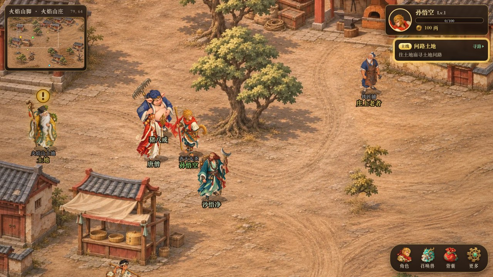
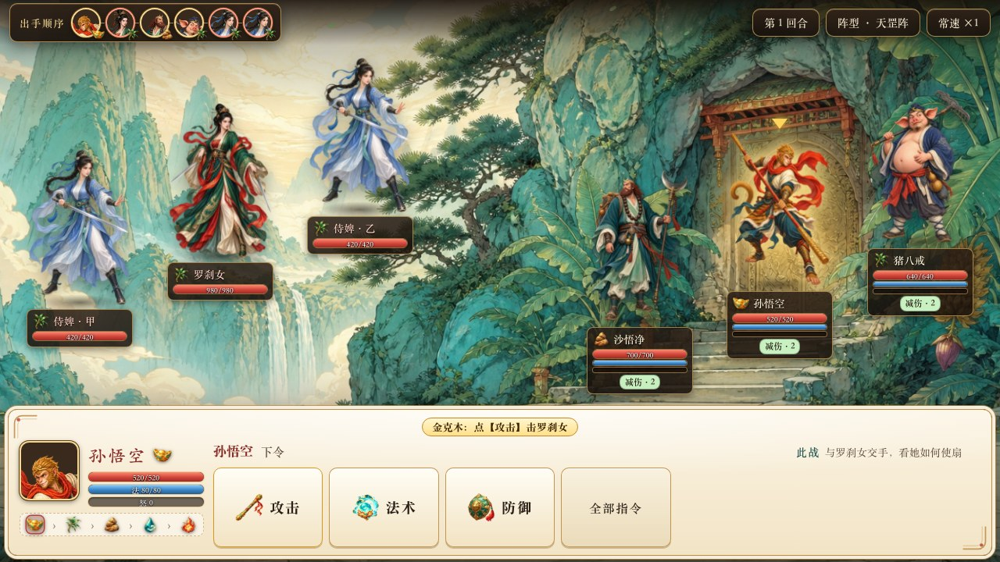
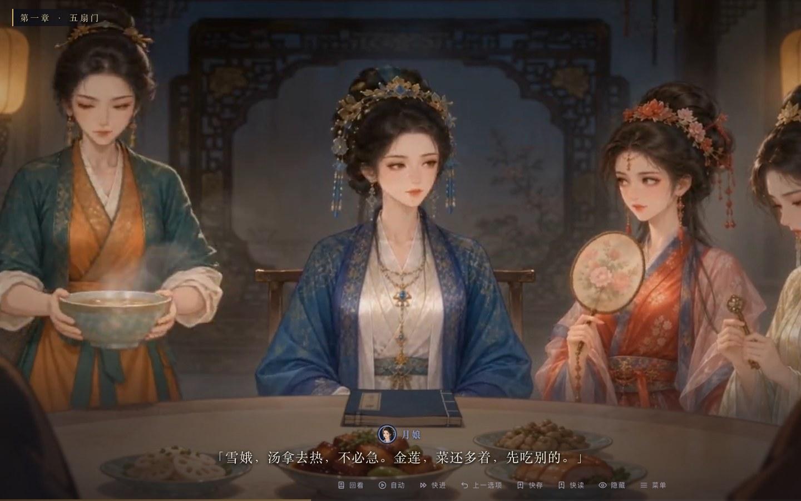

<!-- Last synced with README.md: 2026-11-19 -->

<p align="center">
  
</p>

<h1 align="center">NovelToGame</h1>

<p align="center">
  <b>Five agent skills that turn a novel into a playable game: full-book analysis, game and art design, builds using your local tools, and blind-playtest QA.</b>
</p>

<p align="center">
  <a href="https://zenstory.ai/novel-to-game"><b>Project page</b></a>
  &nbsp;·&nbsp;
  <a href="#install"><b>Install</b></a>
  &nbsp;·&nbsp;
  <a href="#see-what-it-produces"><b>See what it produces</b></a>
  &nbsp;·&nbsp;
  <a href="README.md"><b>中文</b></a>
</p>

<p align="center">
  <a href="https://github.com/zenstory-ai/novel-to-game/stargazers"></a>
  <a href="https://github.com/zenstory-ai/novel-to-game/releases/latest"></a>
  
  <a href="https://github.com/zenstory-ai/novel-to-game/actions/workflows/validate.yml"></a>
  <a href="./LICENSE"></a>
</p>

<p align="center">
  <a href="https://github.com/zenstory-ai/novel-to-game/discussions"></a>
  <a href="https://github.com/zenstory-ai/novel-to-game/issues"></a>
</p>

NovelToGame is a set of five open-source skills for Claude Code, Codex, and Kimi Code. Give it a novel (and optionally a target platform or engine): it reads the whole book to map out the world, picks a fitting gameplay direction, writes the game and art specs, builds the game with the rendering, modeling, or generation tools on your machine, and blind-playtests the result from scratch as a new player before handing back a playable build and the full set of design docs. Both examples below run directly in your browser.

## Play Online

Both examples publish their full workspaces: source edition notes, gameplay selection, game and art specs, runnable source code, and complete-run QA records.

### Journey to the West · Three Borrowings of the Banana Fan

<p>
  <a href="https://xiyouji.vibecoco.ai"></a>
  <a href="https://xiyouji.vibecoco.ai"></a>
</p>

**One wave of a fan blew you fifty thousand li. Walk back, take the quest, and win the mountain one turn at a time.**

A *Fantasy Westward Journey*-style turn-based RPG adapted from chapters 59–61. Walk across four painted maps, pick up quests from NPCs marked with "!", click the tracker to auto-path, and run repeatable demon-bounty dailies between story fights. Earn experience and silver to buy gear, learn spells, and field a pet, then combine five-element counters, rage stunts, and seventy-two transformations to turn an overpowering Bull Demon King into rain over the Mountain of Flames.

**[Play in browser](https://xiyouji.vibecoco.ai)** · [Adaptation workspace](examples/journey-to-the-west/) · ~45–90 min · all ages · playable prototype

### Jin Ping Mei · Ledger of Desire

<p>
  <a href="https://jinpingmei.vibecoco.ai"></a>
  <a href="https://jinpingmei.vibecoco.ai"></a>
</p>

**That spring, five doors kept a lamp lit for you. Whatever you say, they remember.**

An interactive-film romance set in the spring right after Li Ping'er marries into the Ximen household. Every major choice plays a short voiced cutscene showing the immediate fallout, then holds on its final frame as dialogue continues. The common route brings all five women together over dinner, a rainy night, and the Qingming feast; what your words and choices build with each of them decides whose courtyard lamp is still lit when the routes split. Five character routes plus the no-lamp route lead to 16 endings, each closing with a page on her fate in the original novel. Includes timed replies, scene-inspection clues, a chapter story tree, gallery, backlog, and saves.

**[Play in browser](https://jinpingmei.vibecoco.ai)** · [Adaptation workspace](examples/jin-ping-mei/) · ~20–30 min per route, 1–1.5 h for all five · 18+ · playable prototype

## What it is

The five skills run on your coding agent's model and write one Markdown document per stage, keeping what the book says separate from what the game invents:

- **Source facts come with citations** — Reading the full book produces `SOURCE_BIBLE`, mapping main arcs, key conflicts, character relationships, hidden agendas, world rules, and adaptation boundaries with chapter or file citations; anything not in the book is clearly marked as a new addition.
- **Compare gameplay directions first, then stick to the spec** — Viable directions are compared upfront to rule out generic reskins or loops disconnected from the book's conflict. Concept, world/level design, and art direction live in separate docs so coding follows the settled plan instead of improvising mid-build.
- **Include the surrounding experience of a borrowed genre** — When building on an established genre, the design lists how movement, quest guidance, and progression are handled—what is built in full, simplified, or skipped—and what the player sees in minute one.
- **Lock the target platform and build with local tools** — A short product brief locks the target platform, package cap, and runtime upfront; `game-build` checks the tools available on your machine (Three.js, Blender, image/3D generators, 2D Canvas, WeChat/Douyin mini-games, TapTap Maker UrhoX+Lua, Godot/Unity, etc.) and never quietly swaps a missing native toolchain for a plain web page.
- **New-player blind playtest + full-run check** — An isolated session blind-playtests from the title screen without reading code or specs (`qa/playtest-report.md`) to catch progression blockers, unclear onboarding, and mobile viewport issues, then checks the build against the specs and records one complete run covering launch, render, input, core loop, outcome, and restart (`qa/verification.json`).

Alongside systems-driven genres, it supports **interactive fiction** built around scenes, dialogue, testimony, and choices (showing relationship shifts through reactions, forms of address, and later callbacks rather than an affection meter) and **interactive film** with voiced post-choice cutscenes that hold on their last frame as dialogue resumes—still fully playable on static frames with video off ([interactive film method](skills/game-design/references/interactive-film-method.md), [generative media production](skills/game-build/references/generative-media.md), both in Chinese).

## Install

Prerequisite: Claude Code, Codex, or Kimi Code installed, with `npx` (Node.js) available in your terminal.

| Agent CLI | Install | Invoke |
|---|---|---|
| Claude Code | `npx skills add zenstory-ai/novel-to-game -g -y -a claude-code -s '*'` | `/novel-to-game` |
| Codex | `npx skills add zenstory-ai/novel-to-game -g -y -a codex -s '*'` | `$novel-to-game` |
| Kimi Code | `npx skills add zenstory-ai/novel-to-game -g -y -a kimi-code-cli -s '*'` | `/skill:novel-to-game` |

`-g` installs globally; omit it to install into the current directory only. **To update, rerun the same command or `npx skills update`.** Also available on [ClawHub](https://clawhub.ai/) ([publish inventory](.clawhub/publish.json)).

<details>
<summary><strong>All three CLIs at once, or native plugin installation</strong></summary>

Install into all three CLIs on the same machine (cloning this repository also enables automatic project-local discovery):

```bash
npx skills add zenstory-ai/novel-to-game -g -y -s '*' \
  -a claude-code -a codex -a kimi-code-cli
```

#### Claude Code

```text
/plugin marketplace add zenstory-ai/novel-to-game
/plugin install novel-to-game@novel-to-game-skills
/novel-to-game:novel-to-game quick
```

#### Codex

```bash
codex plugin marketplace add zenstory-ai/novel-to-game
codex plugin add novel-to-game@novel-to-game-skills
```

#### Kimi Code 0.27 or newer

```text
/plugins install https://github.com/zenstory-ai/novel-to-game
/reload
/skill:novel-to-game quick
```

</details>

## See what it produces

Excerpts below come directly from the two examples in this repository (Chinese Markdown excerpts are translated here; cuts are marked with "…"):

### What the design documents look like

In [Journey to the West](examples/journey-to-the-west/), [`analysis/SOURCE_BIBLE.md`](examples/journey-to-the-west/analysis/SOURCE_BIBLE.md) maps details about the Banana-Leaf Fan back to specific chapters (translated; 3 of 11 rows):

```markdown
| Fact | Evidence |
|---|---|
| The true fan quells fire with one wave, raises wind with two, brings rain with three; Rakshasi first blows Wukong away with it, and he returns after obtaining the wind-fixing pill from Bodhisattva Lingji | Chapter 59 |
| Wukong turns into an insect and enters her belly to force the fan out of her, but receives a fake; the fake fan raises the flames three times in a row | Chapter 59 |
…
| The Bull Demon King also commands the seventy-two transformations; disguised as Bajie he tricks the true fan back, and Wukong, flushed with success, does not look closely | Chapter 61 |
```

[`concepts/CONCEPT.md`](examples/journey-to-the-west/concepts/CONCEPT.md) builds the core mechanic around the true and fake fans and notes why the two other candidates were cut (translated):

```markdown
One-strike veto check (one line per direction):

- Direction 1 · Three Borrowings of the Banana Fan: passes (none of the six triggered).
- Direction 2 · The Westward Post Road: triggers item 2 — within the slice length, relationship building decays into event buttons and stat bars with no repeatable trade-off — eliminated.
- Direction 3 · Two Hearts: triggers item 3 — in the novel the true and the false are told apart by the Buddha, so the player's core tension cannot become a reliable mechanic (it would need a tell the novel does not contain) — eliminated.
```

[`design/GAME_DESIGN.md`](examples/journey-to-the-west/design/GAME_DESIGN.md) spells out the effects and turn counts for each wave of the true fan, and why timing the third wave is the key call in the final fight (translated):

```markdown
| Order | Effect (all enemies, ignores the five elements) | Source |
|---|---|---|
| First wave · Quell fire | Clears enemy buffs (keeps the guard-break / stun / exposure our side applied); enemy attack −30% (3 turns) | One wave quells fire |
| Second wave · Raise wind | Whole party speed +30% (3 turns), seizing the head of the action queue | Two waves raise wind |
| Third wave · Bring rain | Party heals over time (8% max stamina per action, 3 turns); enemy defence −25% and **exposed (damage taken +60%)**, all for 3 turns | Three waves bring rain |

The three stages are both a power curve and the ritual of the "three borrowings": first suppress the enemy's offence, then seize the initiative, then open the exposure window and focus fire,
taking down the White Bull's true form with your companion beast and transformations. The rain's exposure window is the only chance for a quick kill in the final battle: the White Bull's true form stacks frenzy every turn,
and dragging it out means you will be killed in turn, so "when to open the third wave" is the core decision of the finale.
```

[`qa/verification.json`](examples/journey-to-the-west/qa/verification.json) records the browser run that played through to the ending and restarted:

```json
"completeRun": {
  "id": "three-fans-main-path",
  "cleanContext": true,
  "terminal": "done",
  "restart": "ask",
  "evidence": "qa/evidence/run.json"
},
"checks": {
  "launch": "PASS",
  "render": "PASS",
  "input": "PASS",
  "coreLoop": "PASS",
  "outcome": "PASS",
  "restart": "PASS"
},
```

### How choices carry forward

[Jin Ping Mei](examples/jin-ping-mei/)'s [`concepts/CONCEPT.md`](examples/jin-ping-mei/concepts/CONCEPT.md) lays out what each heroine wants, her underlying wound, and the source chapters behind it (translated; 3 of 5 rows):

```markdown
Core sentence: **Whatever you said, they remember.**
…
| Character | What she wants | Her wound | Source basis |
|---|---|---|---|
| Wu Yueniang | To be asked first about what matters | She is the principal wife only in front of others | Chapters 1, 21 |
| Pan Jinlian | To be seen, to be chosen first | Apart from the way you look at her, she has nothing | Chapters 8, 9, 38 |
| Li Ping'er | Safety and certainty | Seen first as a trunk of valuables, only later as a person | Chapters 14, 16, 19 |
```

[`design/GAME_DESIGN.md`](examples/jin-ping-mei/design/GAME_DESIGN.md) keeps affection numbers off-screen, ties each route's turning point to that wound, and sets the ending rules (translated; 2 of 5 rows):

```markdown
Choices show no numbers. Affection has only three outlets: her expression and lines; whether her courtyard door is "lit" on the night the routes split; and an optional "feelings" glance in the system menu
(only her look and "the lamp is lit / the lamp is going out", no tiers and no numbers). Yueniang states the rule in the first chapter: on the night the Qingming feast breaks up, only a door still lit can be entered.
…
| Character | Source basis | Key choice (the right move) | Good | Ordinary | Missed |
|---|---|---|---|---|---|
…
| Pan Jinlian | Chapters 8, 38: sends verses longing for him; plays the pipa on a snowy night | Do not open Ping'er's trunks for her, but stay with her tonight | The pipa is not cold | The side gate left ajar | The fan falls |
| Li Ping'er | Chapters 14, 19: entrusts herself over the garden wall; met coldly when she marries in | Do not take her keys; say in front of everyone that her silver is hers | The keys in her hand | Tea under the window | The trunks |
…
Ending rule: get the key choice wrong → Missed; get it right, with her affection ≥7 and the truth told at the last question → Good; otherwise → Ordinary.
```

## Usage

Hand the agent a novel file, folder, or link, then copy and tweak any prompt below.

**A systems-driven game with an original route:**

```text
Use novel-to-game quick to adapt this novel into a fully playable game.
Recommend a platform, genre, and engine from the book, and keep the first build to around 15 minutes.
Let the player enter the world as an original character and carve out a new route through its conflict.
```

**An interactive story:**

```text
Use novel-to-game quick to adapt this novel into an interactive story.
Drive the story through continuous scenes, dialogue, testimony, and key choices; track cause and effect in the background without a persistent stat panel.
Key choices should change later scenes, character attitudes, and the ending, with clear callbacks later on.
```

**Design docs only, no code yet:**

```text
Based on this novel I have rights to adapt, write a compact playable-slice design spec for my target engine.
Keep the branches and endings bounded, and show each option's basis, cost, visible outcome, and which later scene follows up on it.
Mark new additions and open questions clearly. Deliver design docs only—do not write code or run QA.
```

**A WeChat/Douyin mini-game or TapTap Maker game:**

```text
Use novel-to-game quick to adapt this novel into a portrait WeChat/Douyin mini-game (or a TapTap Maker UrhoX+Lua game).
Keep each run to 2–3 minutes, get into the conflict within 30 seconds, and end with a shareable verdict card; rewarded ads may offer hints or retries without locking the main plot.
Deliver a real package for the target platform; if platform dev tools are missing locally, ask before using a local test page for QA.
```

The default `quick` mode proposes sensible defaults, stops to ask only on major calls like platform, core gameplay, rights, or paid generation, and runs the rest automatically. Swap `quick` for `director` if you want to sign off on the gameplay concept, post-graybox cuts, and visual sample frames yourself.

## Workflow

```text
Novel → Book analysis → Gameplay pick → World design → Graybox playtest ↺ → Art direction → Full build → Live QA
```

Once world design is settled, the core loop is built as a playable graybox (controls and space in place, final art held back) and played from scratch by an isolated session to make sure it is clear and fun before bulk art, full implementation, in-game copy polish, and QA. All specs and code live in `game-adaptations/<project>/`, with engine-independent Markdown design docs:

| Skill | Role | Main outputs |
|---|---|---|
| [`novel-to-game`](skills/novel-to-game/) | Confirm scope, pick a mode, coordinate stages, and resume interrupted runs | `PRODUCT_BRIEF.md`, `_progress.md` |
| [`novel-game-analyze`](skills/novel-game-analyze/) | Read the full book and organize arcs, key scenes, relationships, secrets, world rules, and red lines | `analysis/SOURCE_BIBLE.md` |
| [`game-design`](skills/game-design/) | Step through gameplay selection, world/level/narrative design, and visual/audio style | `concepts/CONCEPT.md`, `design/GAME_DESIGN.md`, `design/ART_DIRECTION.md` |
| [`game-build`](skills/game-build/) | Check local tools, build a playable graybox then the full game, polish in-game text, and wire tests | `build/BUILD_BRIEF.md`, `build/app/` |
| [`game-qa`](skills/game-qa/) | Cold-start blind playtest as a new player, check against specs, and write the verification record | `qa/playtest-report.md`, `qa/verification.json` |

## FAQ

### How long does a run take, and what does it cost?

Reading the book, writing specs, coding, and running QA usually spans several sessions, billed in tokens by your coding agent; external image, video, or voice tools are off by default and only used after you confirm. If quota gets tight, side branches and extra scenes are trimmed first so the main game stays complete.

### Can I pick up where I left off if a session drops?

Yes. Run `novel-to-game resume`—it checks `_progress.md`, existing docs, and `qa/verification.json` to continue from the last finished stage.

### Which engines or platforms are supported? Will it fall back to a web page if tools are missing?

Platform and engine are locked in the initial brief; if the target toolchain is not installed on your machine, it will never quietly switch to a web game—it only uses an alternate test setup if you approve, logging untested parts under `limitations`. WeChat/Douyin mini-games and TapTap Maker (UrhoX + Lua) are packaged to each platform's real spec ([WeChat and Douyin mini-game spec](skills/game-build/references/wechat-and-douyin-minigame.md), [TapTap Maker spec](skills/game-build/references/taptap-maker.md), both in Chinese).

### Can the novel and the game be in different languages?

Yes. Novels can be in any language, while docs and in-game text follow the language you ask for (or your chat language); original quotes and cultural terms are kept intact with a shared glossary for names and rules.

## Acknowledgments

<https://linux.do>

## Part of ZenStory AI

This project is maintained by [ZenStory AI](https://zenstory.ai) — a suite of open-source AI tools for story writing, adaptation, and production (GitHub org: [zenstory-ai](https://github.com/zenstory-ai)). Sibling projects:

| Project | What it does |
| --- | --- |
| [oh-story-claudecode](https://github.com/zenstory-ai/oh-story-claudecode) | Web-fiction writing skill pack: chart scanning, deconstruction, drafting, de-AI-flavor, covers |
| [drama-skills](https://github.com/zenstory-ai/drama-skills) | AI short-drama / motion-comic suite: scripts, assets, storyboards, image & video prompts, review |
| [novel-to-game](https://github.com/zenstory-ai/novel-to-game) | Agent skills for source-grounded novel adaptation, target-runtime builds, and evidence-based QA (this repo) |
| [video-recap-skills](https://github.com/zenstory-ai/video-recap-skills) | Create Chinese-narration recaps from supported video files, with optional editable JianYing/CapCut draft export |
| [oh-story-dsh](https://github.com/zenstory-ai/oh-story-dsh) | Community DeepSeek Harness plugin with novel, short-drama, game and video-recap workbenches |
| [zenstory](https://github.com/zenstory-ai/zenstory) | Chat-to-create AI novel-writing workbench ([app.zenstory.ai](https://app.zenstory.ai)) |
